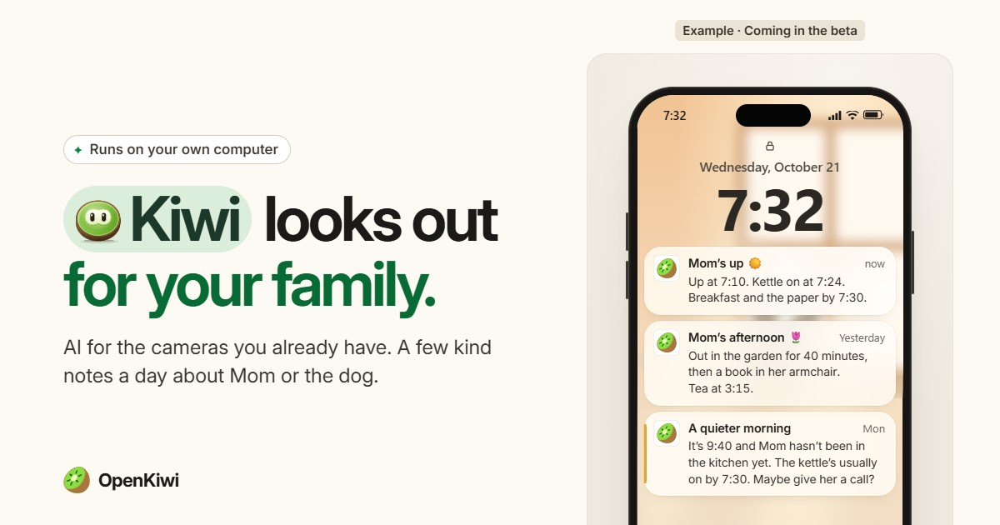
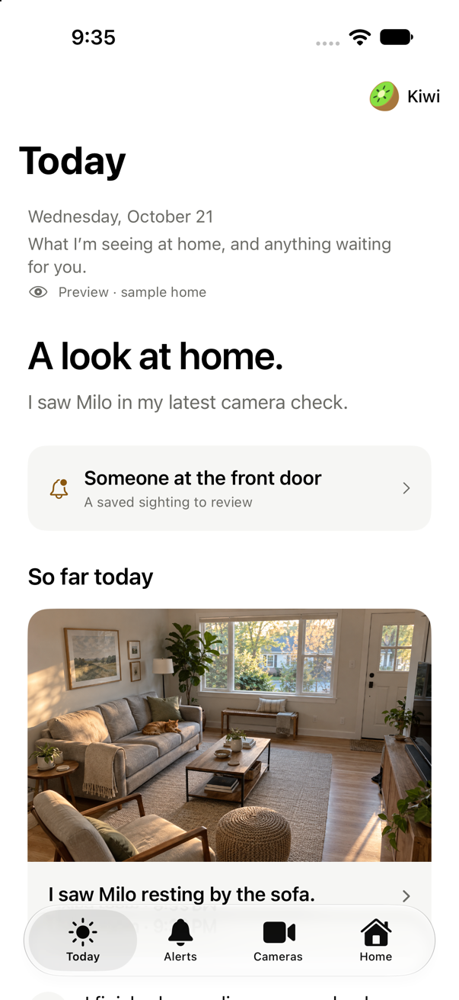
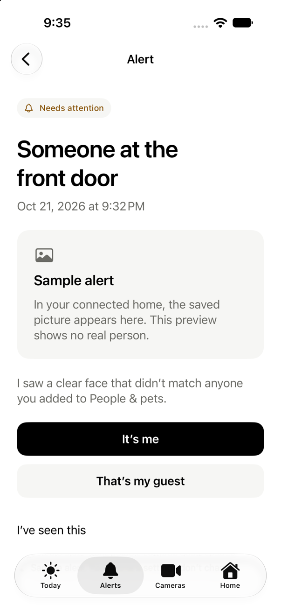
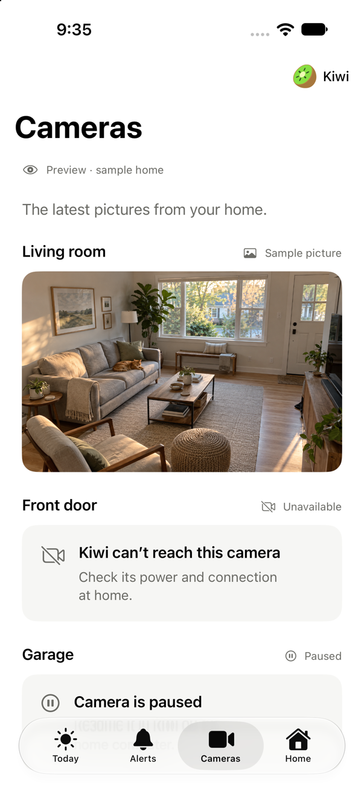
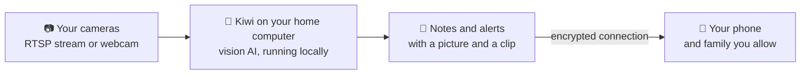

# OpenKiwi

### Private AI for the cameras you already have.

Kiwi runs on a computer in your home, looks in on your parents, pets and home through your cameras, 
and sends a few kind words a day, plus a tap on the shoulder when something may need you.

[**Join the waitlist →**](https://openkiwi.ai/?s=github#signup) &nbsp;·&nbsp; [Website](https://openkiwi.ai) &nbsp;·&nbsp; [How it works](#how-it-works) &nbsp;·&nbsp; [Questions](#questions) &nbsp;·&nbsp; [Guides](https://openkiwi.ai/guides/)

> [!NOTE]
> **OpenKiwi is in development.** There is no public download yet: the beta will open to the first families in small groups.
> [Join the waitlist](https://openkiwi.ai/?s=github#signup) and we'll write when your invite is ready. We plan to make the code
> open source, and this repository is where it will live. **Star or watch it** to hear when the beta and the source arrive.

---

## Why Kiwi

I travel a lot, and when I'm away I worry about my parents and my pets. I can't just drop by, and I don't want to spend my trips
watching a camera feed. So I'm building Kiwi, to help families know they're okay without watching.

AI can now understand what's happening in a room, and it can run on a computer at home, so the video doesn't have to leave the
house. That's Kiwi.

— Connor, founder of OpenKiwi

## What Kiwi does

Tell Kiwi who it's looking after, and it turns on what they need.

<table>
<tr>
<th width="33%">A parent who lives alone</th>
<th width="33%">A dog or cat home alone</th>
<th width="33%">The home</th>
</tr>
<tr valign="top">
<td>

- A short **Daily OK** note each morning: when she was up, and where.
- A **nudge** if Kiwi hasn't seen her by the time you set.
- **Falls, with follow-ups**: "Up again" or "Still down".
- A family list: one person taps **I'm on it**, and the others stand down.

</td>
<td>

- **The day in a few lines**, with a photo: when they ate, where they napped, when they played.
- **When Kiwi last saw them.**
- Whether the **walker or sitter** came, and when.
- No paywall to see your own pet, and no bark alerts: Kiwi doesn't use sound.

</td>
<td>

- **Fire and forced entry**, on from the start.
- **Anyone unfamiliar** while you're out, set by one tap or a schedule.
- A message if **Kiwi stops watching**.
- **See live** from anywhere, for you and the family you allow.

</td>
</tr>
</table>

Every alert comes with the saved picture and a clip of about 20 seconds, and says what happened in plain words.

&nbsp;

&nbsp;

 
The iPhone app's sample-home preview. Kiwi isn't released yet; screens may change.

## How it works

1. **Connect your cameras.** Kiwi looks for cameras on your network that offer an RTSP stream, as many wired home cameras do, or you can use a webcam.
2. **Choose who it looks after.** A parent, a pet or the home, and Kiwi turns on what they need.
3. **Get on with your day.** A vision model on your own computer keeps an eye on things, and Kiwi speaks up only when something may need you.

## Private by design

- **The AI runs on your computer.** Your video isn't sent to a cloud to be stored or analysed.
- **Served from home.** Pictures, clips and live view come from your home computer over an encrypted connection. If you turn on phone access, a connection service we run passes that traffic along and keeps no pictures or video.
- **No sound.** Kiwi doesn't use audio, so there are no bark alerts and nothing it overhears.
- **No ads, no trackers.**
- **Known, not hidden.** Tell the people at home that Kiwi is there, and choose the rooms together. Bedrooms and bathrooms stay out unless they agree.

Your camera maker's own cloud settings are separate from Kiwi.

## What you'll need

| | |
|---|---|
| **A computer that stays on at home** | A Windows PC with an NVIDIA graphics card, or an Apple silicon Mac. The exact requirements come with the beta. |
| **A camera** | One with an RTSP stream, or a webcam. Cloud-only cameras such as Ring, Nest and Blink don't work with Kiwi. Not sure about yours? [How to check](https://openkiwi.ai/guides/add-ai-to-existing-security-cameras#check) |
| **Internet, once** | The first setup downloads the AI model |

## How Kiwi compares

An honest summary. Our [guides](https://openkiwi.ai/guides/) go deeper, with sources, and say plainly when something else is the better fit.

| | **Kiwi** | **A camera maker's AI plan** | **Frigate + Home Assistant** |
|---|---|---|---|
| Where the AI runs | Your computer | The maker's cloud | Your computer |
| Monthly fee | None for what runs at home | Yes | None |
| Setup | An app, no Docker | The maker's app | Docker and configuration |
| Tells you in plain words | Yes | On some plans | With add-ons such as LLM Vision |
| Works with Ring, Nest, Blink | No | Their own cameras | No |
| Ready today | No: in development | Yes | Yes, and mature |

If you're comfortable with Docker, Frigate is more mature today: see [Frigate vs. Kiwi](https://openkiwi.ai/guides/frigate-vs-kiwi).
For cloud cameras, see [How to add AI to existing security cameras](https://openkiwi.ai/guides/add-ai-to-existing-security-cameras).

## What Kiwi isn't

Kiwi can miss things or raise false alerts, and it can't see rooms without a camera. It isn't a smoke alarm, a monitored alarm
or an emergency service, it doesn't call 911, and it doesn't replace a medical alert. Only point cameras where you may record,
and tell the people there.

## Questions

<b>Is OpenKiwi open source?</b>

 
Not yet. We plan to make the code open source, so anyone can check it, and free to use at home. When it is, it will be published here.

<b>What will it cost?</b>

 
Nothing during the beta, and nothing that runs at home needs a subscription.

<b>Does it send my camera video to the cloud?</b>

 
No. The AI runs on your own computer. If you turn on phone access, a connection service we run passes the encrypted traffic along and keeps no pictures or video.

<b>Which cameras will work?</b>

 
Cameras with an RTSP stream, or a webcam. Many wired cameras offer RTSP, often as a setting in the camera's app. Cloud-only cameras such as Ring, Nest and Blink don't work with Kiwi.

<b>When can I try it?</b>

 
The beta will open to the first families in small groups. <a href="https://openkiwi.ai/?s=github#signup">Join the waitlist</a>, or email <a href="mailto:hello@openkiwi.ai">hello@openkiwi.ai</a> to ask about trying it sooner.

<b>Is this the OpenKiwi translation-quality library?</b>

 
No. That's <a href="https://github.com/Unbabel/OpenKiwi">Unbabel's OpenKiwi</a>, a machine-translation quality-estimation framework. This is OpenKiwi, the home app at <a href="https://openkiwi.ai">openkiwi.ai</a>.

More answers: [openkiwi.ai](https://openkiwi.ai/#questions) · Privacy in full: [openkiwi.ai/privacy](https://openkiwi.ai/privacy)

## Get in touch

- **Try Kiwi first:** [join the waitlist](https://openkiwi.ai/?s=github#signup)
- **Questions, beta access, press:** [hello@openkiwi.ai](mailto:hello@openkiwi.ai)
- **Follow along:** [YouTube](https://www.youtube.com/@openkiwiai) · [Instagram](https://www.instagram.com/openkiwi.ai/) · [TikTok](https://www.tiktok.com/@openkiwi) · [X (Connor)](https://x.com/ConnorOpenKiwi)
- **Security:** please email [hello@openkiwi.ai](mailto:hello@openkiwi.ai) rather than opening a public issue

---

Made in San Francisco by <a href="https://openkiwi.ai/#founder">Connor</a> · <a href="https://openkiwi.ai">openkiwi.ai</a> · <a href="https://openkiwi.ai/privacy">Privacy</a>

